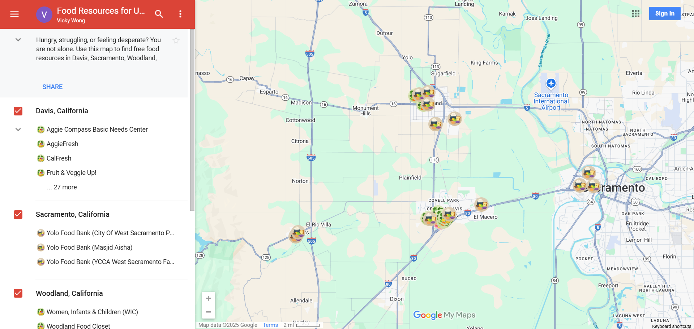

  <h1>🍉 Food Resources for UC Davis Students</h1>

  

    An interactive map identifying free food resources
    for UC Davis students across nearby communities.
  

<h2>📑 Table of Contents</h2>

<ul>
  <li><a href="#objective">Objective</a></li>
  <li><a href="#inspiration">Inspiration</a></li>
  <li><a href="#project-details">Project Details</a></li>
  <li><a href="#map">Map</a></li>
  <li><a href="#images">Images</a></li>
</ul>

<h2 id="objective">🎯 Objective</h2>

  This project is spontaneously inspired by
  <em>Remy's Recipe for Food Insecurity</em> poster
  at The Green at West Village, Davis, California,
  United States. It integrates resources from Aggie
  Compass, campus food programs, and community food
  initiatives to support the University of California,
  Davis students facing food insecurity.

<h2 id="inspiration">🎬 Inspiration</h2>

<h3>Remy from Ratatouille</h3>
<table>
  <tr>
    <td>
      
    </td>
  </tr>
</table>

  <a href="https://www.youtube.com/watch?v=NvM3nMbyeM8">
    Watch Video
  </a>

<h2 id="project-details">🛠️ Project Details</h2>

  <strong>Tools:</strong> Google Maps, Canva

<h2 id="map">🧭 Map</h2>

  <a href="https://www.google.com/maps/d/u/0/edit?mid=1t1K7LJij3VG0_I-Iuf8NwHES3_MxRYg&amp;usp=sharing">
    View Map
  </a>

<h2 id="images">🖼️ Images</h2>

<h3>Food Resources for UC Davis Students Map</h3>

<table>
  <tr>
    <td>
      
    </td>
  </tr>
</table>

  

    <a href="https://github.com/redefiningvicky/Technical-Projects">
      Back to Technical Projects
    </a>
    &nbsp; • &nbsp;
    <a href="https://github.com/redefiningvicky/redefiningvicky">
      Back to Portfolio
    </a>
  

